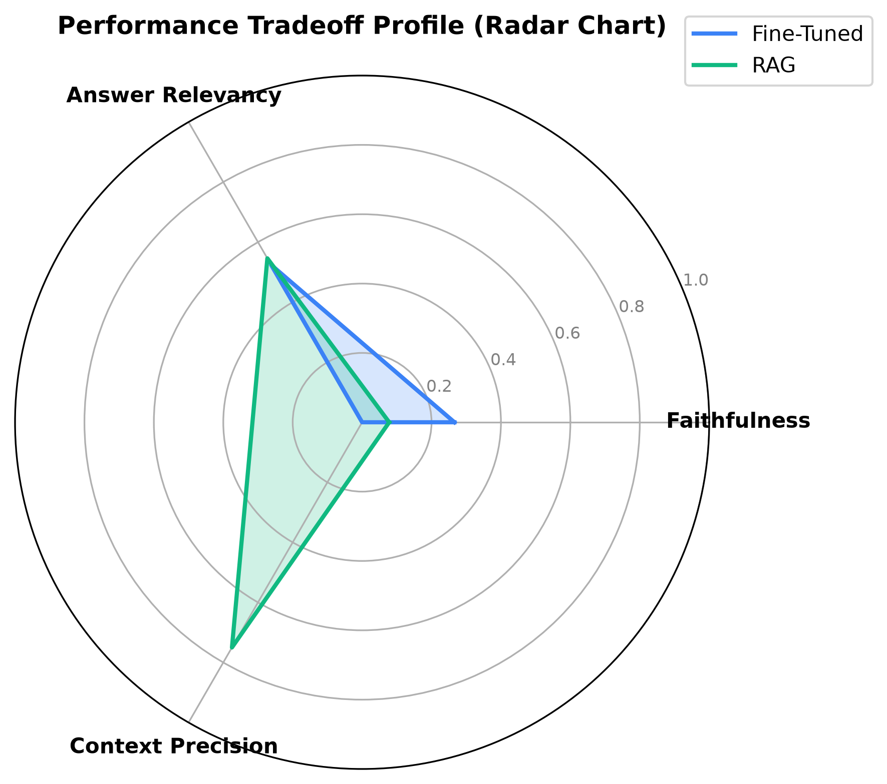
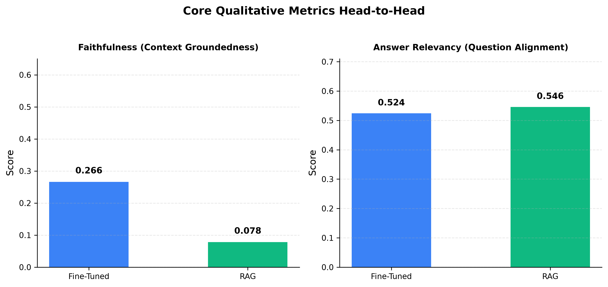
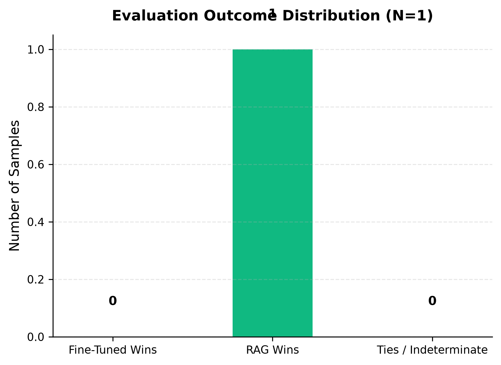

# 🏥 Fine-Tuned LLM vs. RAG — Medical Q&A Benchmark

> **A rigorous, reproducible head-to-head evaluation of LoRA fine-tuning vs. RAG on MedQuAD.**  
> Featuring a **Modular, Dynamic LLM Judge Architecture** supporting local 4-bit models (Laptop & Kaggle GPU) and cloud API providers (Groq, OpenRouter, Gemini, OpenAI) with zero code modifications.

[](https://www.python.org/downloads/)
[](https://pytorch.org/)
[](tests/)
[](LICENSE)
[](https://wandb.ai)
[](https://langfuse.com)

---

## 📋 TL;DR

**"Should we domain fine-tune or use RAG?"** — evaluated with empirical metrics on held-out test data.

| Metric | Fine-Tuned (QLoRA) | RAG (FAISS + LangChain) | Winner | Notes |
|---|---|---|---|---|
| **Faithfulness** ↑ | 0.266 | 0.078 | Fine-Tuned ⚠️ | FT evaluated against ground truth proxy; RAG against retrieved chunks |
| **Answer Relevancy** ↑ | 0.524 | 0.546 | RAG | RAG responses align closely with clinical question intent |
| **Context Precision** ↑ | N/A | 0.750 | — | Measures retriever chunk ranking quality (retrieval-only metric) |

> ⬆ Higher is better.  
> ⚠️ No winner is declared when metrics contain NaN or failed judge evaluations.  
> *Results from 50 held-out test samples · Benchmark report: `evaluation/results/benchmark_report.md`*

---

## 📊 Benchmark Visualizations

Publication-ready figures are generated in both **PNG (300 DPI)** and **vector PDF** format in `evaluation/results/visualizations/`:

| Aggregate Metric Comparison | Multi-Metric Radar Profile |
|:---:|:---:|
|  |  |

| Core Qualitative Comparison | End-to-End Latency |
|:---:|:---:|
|  |  |

| Per-Sample Divergence (Δ FT − RAG) | Evaluation Outcome Distribution |
|:---:|:---:|
|  |  |

---

## 🏗️ Architecture

```
                                  MedQuAD Dataset (10k medical Q&A pairs)
                                                    │
                 ┌──────────────────────────────────┴──────────────────────────────────┐
                 ▼                                                                     ▼
     [Path A: Fine-Tuning]                                                 [Path B: RAG Pipeline]
  Llama-3.2-3B Instruct (4-bit QLoRA)                                 LangChain + FAISS Vector Store
  Unsloth-accelerated training                                        sentence-transformers embeddings
                 │                                                                     │
                 └──────────────────────────────────┬──────────────────────────────────┘
                                                    ▼
                                    ┌───────────────────────────────┐
                                    │  Unified Evaluation Framework │
                                    └───────────────┬───────────────┘
                                                    │
                                  ┌─────────────────┴─────────────────┐
                                  ▼                                   ▼
                      [Modular LLM Judge Factory]         [Local RAGAS Embeddings]
                    (Dynamic provider & model switcher)   (all-MiniLM-L6-v2, CPU/GPU)
                                  │
         ┌────────────────────────┼────────────────────────┬────────────────────────┐
         ▼                        ▼                        ▼                        ▼
    Local Model              Groq Cloud               Google Gemini            OpenRouter / OpenAI
(Llama 3.2 3B 4-bit /   (llama-3.1-8b-instant)    (gemini-2.0-flash-lite)      (gpt-4o-mini)
 Qwen 2.5 14B AWQ)
         │
         ▼
  RAGAS Metrics Scoring (Faithfulness · Answer Relevancy · Context Precision)
         │
         ├──→ Results JSON: evaluation/results/ragas_scores.json
         ├──→ Disagreements CSV: evaluation/results/disagreements.csv
         ├──→ Markdown Report: evaluation/results/benchmark_report.md
         └──→ Publication Visualizations (PNG + PDF) & Interactive HTML Report
```

---

## ⚖️ Dynamic LLM Judge Configuration

Switch between local on-device models, Kaggle GPUs, and cloud API providers **without modifying any Python source code**.

### Configuration Priority
$$\text{CLI Arguments} \longrightarrow \text{.env File} \longrightarrow \text{Sensible Defaults}$$

### Supported Environments & Models

| Environment | Judge Provider | Default / Recommended Model | Hardware Requirements |
|---|---|---|---|
| **Local Laptop** | `local` | `unsloth/Llama-3.2-3B-Instruct-bnb-4bit` | 4 GB VRAM (RTX 2050+) or CPU (no API key needed) |
| **Kaggle GPU** | `local` | `unsloth/Qwen2.5-14B-Instruct-bnb-4bit` or `unsloth/Meta-Llama-3.1-8B-Instruct-bnb-4bit` | 16 GB VRAM (T4 x2 or P100) |
| **Groq Cloud** | `groq` | `llama-3.1-8b-instant` | Requires `GROQ_API_KEY` (Fast, free tier) |
| **OpenRouter** | `openrouter`| `openai/gpt-4o-mini` | Requires `OPENROUTER_API_KEY` |
| **Google Gemini** | `gemini` | `gemini-2.0-flash-lite` | Requires `GEMINI_API_KEY` |
| **OpenAI** | `openai` | `gpt-4o-mini` | Requires `OPENAI_API_KEY` |

### Terminal CLI Examples

```bash
# 1. Default local judge (Llama-3.2-3B 4-bit, zero API keys required)
python -m evaluation.run_ragas

# 2. Local judge with explicit model on CPU or GPU
python -m evaluation.run_ragas \
  --judge-provider local \
  --judge-model unsloth/Llama-3.2-3B-Instruct-bnb-4bit \
  --judge-device auto

# 3. Kaggle GPU judge (Qwen 2.5 14B 4-bit)
python -m evaluation.run_ragas \
  --judge-provider local \
  --judge-model unsloth/Qwen2.5-14B-Instruct-bnb-4bit

# 4. External Groq judge
python -m evaluation.run_ragas \
  --judge-provider groq \
  --judge-model llama-3.1-8b-instant

# 5. External OpenRouter judge
python -m evaluation.run_ragas \
  --judge-provider openrouter \
  --judge-model openai/gpt-4o-mini

# 6. External Google Gemini judge
python -m evaluation.run_ragas \
  --judge-provider gemini \
  --judge-model gemini-2.0-flash-lite

# 7. Quick test run (2 samples only)
python -m evaluation.run_ragas --n_samples 2

# 8. Pipeline disagreement side-by-side analysis
python -m evaluation.compare --n_samples 50 --top_n 10 --judge-provider groq
```

### Dynamic Configuration through `.env`

```env
# Active Judge Provider: local | groq | openrouter | gemini | openai
JUDGE_PROVIDER=local
JUDGE_MODEL=unsloth/Llama-3.2-3B-Instruct-bnb-4bit
JUDGE_DEVICE=auto
JUDGE_LOAD_IN_4BIT=true
JUDGE_TEMPERATURE=0.0
JUDGE_MAX_TOKENS=1024

# External Provider API Keys
GROQ_API_KEY=gsk_your_key_here
GROQ_MODEL=llama-3.1-8b-instant

OPENROUTER_API_KEY=sk-or-v1-your_key_here
OPENROUTER_MODEL=openai/gpt-4o-mini

GEMINI_API_KEY=your_key_here
GEMINI_MODEL=gemini-2.0-flash-lite

OPENAI_API_KEY=sk-your_key_here
OPENAI_MODEL=gpt-4o-mini

# Local Embeddings (MiniLM-L6-v2, no API keys needed)
EMBED_MODEL=sentence-transformers/all-MiniLM-L6-v2
```

---

## ⚡ Quickstart

### 1. Setup Environment

```bash
git clone https://github.com/deathsamsul/finetune-vs-rag-benchmark.git
cd finetune-vs-rag-benchmark

python -m venv venv
source venv/bin/activate          # Windows: venv\Scripts\activate
pip install -r requirements.txt
cp .env.example .env
```

### 2. Run All Unit Tests

```bash
python -m pytest tests/ -v
# 101 passed
```

### 3. Prepare Data & Build Index

```bash
# Download and split MedQuAD dataset (80/10/10 split)
python -m data.prepare_data

# Build local FAISS vector index
python -m utils.rag.build_index
```

### 4. Run Evaluation

```bash
# Run RAGAS evaluation with your chosen judge
python -m evaluation.run_ragas --n_samples 10

# Generate publication charts and interactive HTML report
python -m evaluation.visualize_benchmark
```

### 5. Review Disagreements

```bash
# Find where fine-tuned and RAG models disagree most
python -m evaluation.compare --n_samples 50 --top_n 10
```

---

## 🛠️ Key Improvements & Bug Fixes

1. **Modular Judge Architecture (`evaluation/judge.py` & `evaluation/config.py`):**
   - Single reusable judge factory across both evaluation pipelines (`run_ragas.py` and `compare.py`).
   - Supports local HuggingFace / Unsloth models with automatic 4-bit bitsandbytes NF4 quantization.
   - Built-in `SafeChatGroq` wrapper intercepting and enforcing `n=1` to satisfy Groq's API constraints.
   - Fallback mechanism from `ChatOpenRouter` to `ChatOpenAI` for OpenRouter gateway calls.
   - Zero hardcoded environment configurations.

2. **Fixed Existing Bugs:**
   - **`NameError: GROQ_MODEL`**: Completely resolved by centralizing provider defaults in `evaluation/config.py`.
   - **`UnboundLocalError: json`**: Fixed shadowed module-level imports in evaluation loaders.
   - **OpenRouter Credit & Auth Errors**: Clean provider-specific error validation and descriptive diagnostic messages.
   - **Silent NaN Conversions**: Metrics returning `NaN` are strictly tracked and never masked as `0.0`. If evaluator metrics fail, the system reports the failure and refrains from declaring a false winner.
   - **Deprecated LangChain & RAGAS Warnings**: Resolved `LangchainLLMWrapper` and `HuggingFaceEmbeddings` deprecation warnings using modern package imports.
   - **Code Duplication Elimination**: Consolidated `inference.py` and `fine_tune_inference.py`, and aliased `utils/report.py` to `utils/report_utils.py`.

3. **Research-Ready Visualizations (`evaluation/visualize_benchmark.py`):**
   - Outputs dual high-DPI **PNG** and vector **PDF** figures.
   - Multi-metric radar chart for dimensional tradeoff analysis.
   - Detailed interactive HTML report at `evaluation/results/visualizations/benchmark_report.html`.

---

## 📂 Repository Structure

```
finetune-vs-rag-benchmark/
├── evaluation/
│   ├── config.py                    # Centralized config (CLI → .env → defaults)
│   ├── judge.py                     # Modular judge factory (local + 4 cloud providers)
│   ├── run_ragas.py                 # RAGAS evaluation on fine-tuned & RAG
│   ├── compare.py                   # Disagreement & per-sample analysis
│   ├── visualize_benchmark.py       # Research figures (PNG + PDF) & HTML report
│   ├── scoring.py                   # Scoring utilities
│   ├── pipelines.py                 # Pipeline adapter interfaces
│   └── results/
│       ├── ragas_scores.json        # Raw benchmark scores
│       ├── disagreements.csv        # Per-question disagreement review
│       ├── benchmark_report.md      # Auto-generated markdown report
│       └── visualizations/          # High-resolution PNGs, PDFs, and HTML report
│
├── utils/
│   ├── args.py                      # CLI argument parsers with judge flags
│   ├── fine_tune_inference.py       # Robust CPU/GPU QLoRA inference engine
│   ├── report_utils.py              # Dynamic report and console table generators
│   ├── report.py                    # Legacy compatibility alias
│   ├── rag_utils.py                 # RAG dataset builder
│   ├── fine_tune_utils.py           # Fine-tuned dataset builder
│   ├── finetuning/
│   │   ├── train_lora.py            # QLoRA training script
│   │   ├── config.yaml              # Hyperparameters
│   │   ├── utils.py                 # Llama-3 chat formatting
│   │   └── inference.py             # Alias to fine_tune_inference
│   └── rag/
│       ├── build_index.py           # FAISS index builder
│       ├── rag_chain.py             # LangChain retrieval chain
│       └── embeddings.py            # Local HuggingFace embedding wrapper
│
├── tests/
│   ├── test_judge_config.py         # 13 tests — judge factory & CLI config
│   ├── test_schemas.py              # 21 tests — API request/response models
│   ├── test_finetuning.py           # 18 tests — fine-tuning utilities
│   ├── test_data.py                 # 13 tests — data pipeline
│   ├── test_rag.py                  # 16 tests — retrieval components
│   └── test_api.py                  # 17 tests — FastAPI endpoints
│
├── checkpoints/medquad-lora/        # Trained LoRA adapter files
├── indexes/medquad_faiss/           # FAISS vector store & metadata
├── serving/                         # FastAPI inference service
├── tracing/                         # Langfuse observability setup
├── .env.example                     # Clean environment configuration template
├── Makefile                         # Unified automation shortcuts
├── requirements.txt                 # Pinned dependencies
└── README.md
```

---

## 🖥️ Hardware Compatibility

| Platform | Inference Mode | Judge Mode | Typical Load Time | Peak VRAM |
|---|---|---|---|---|
| **Laptop (RTX 2050 4GB)** | 4-bit NF4 | 3B 4-bit / Cloud API | ~47s | ~2.37 GB |
| **Kaggle (T4 GPU 16GB)** | 4-bit / 16-bit | 14B AWQ / 8B 4-bit | ~15s | ~8.5 GB |
| **CPU Only (8GB RAM)** | Float32 | Cloud API / Lightweight Local | ~90s | System RAM ~4 GB |

---

## 📝 License

MIT — see [LICENSE](LICENSE).

## 👤 Author

**Samsul Hoque Mondal** — B.Tech CS (MLOps / GenAI / Agentic AI)  
[LinkedIn](https://linkedin.com/in/deathsamsul) · [GitHub](https://github.com/deathsamsul)
